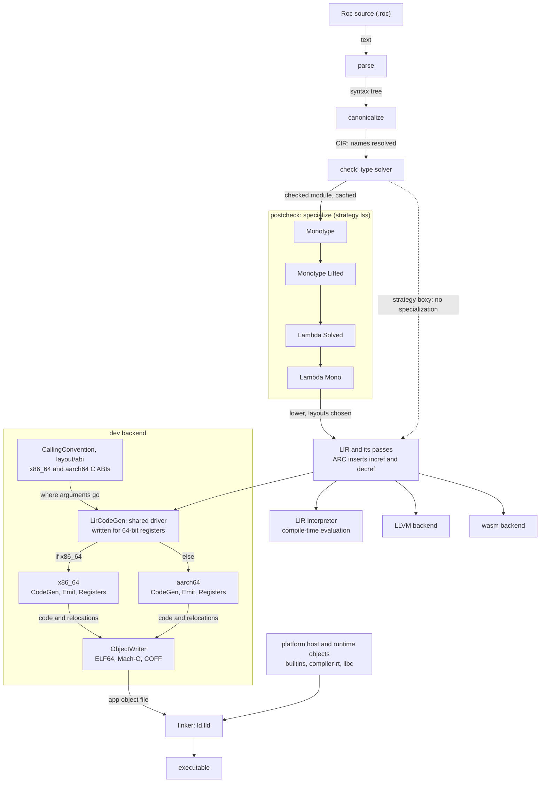
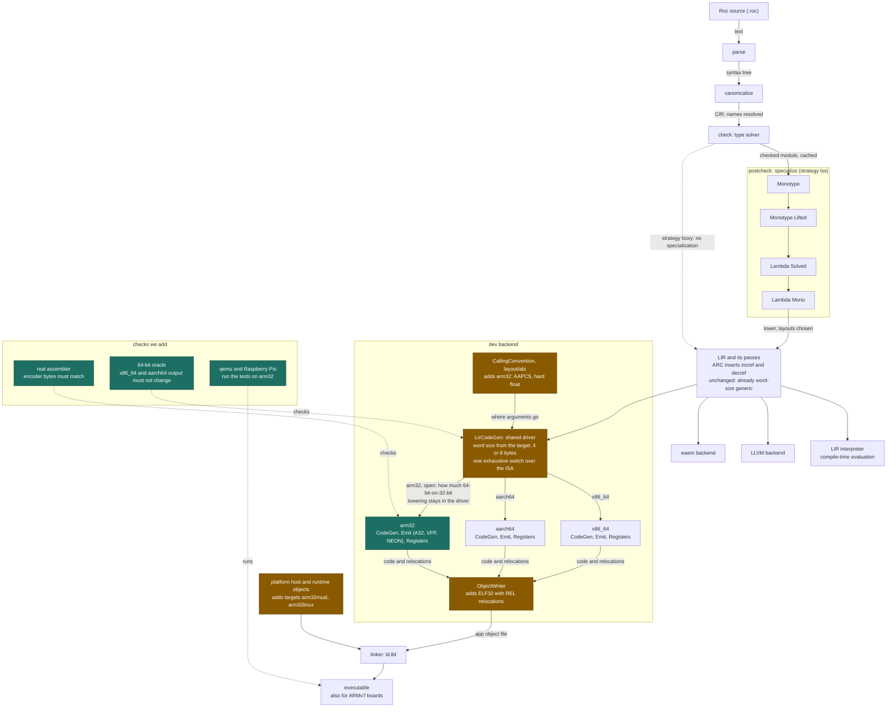

# Compiler charts

The Roc compiler's pipeline today, and with
the arm32 dev backend added. Written 2026-10-02 from `design.md`, the source
layout and `src/backend/dev/arm32/DESIGN.md`.

## Today (upstream, without our changes)

## With the arm32 changes

Green is new, amber is existing code we change. Everything above LIR is
untouched.

